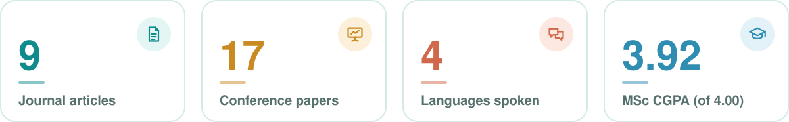
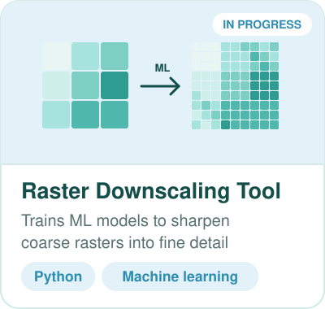
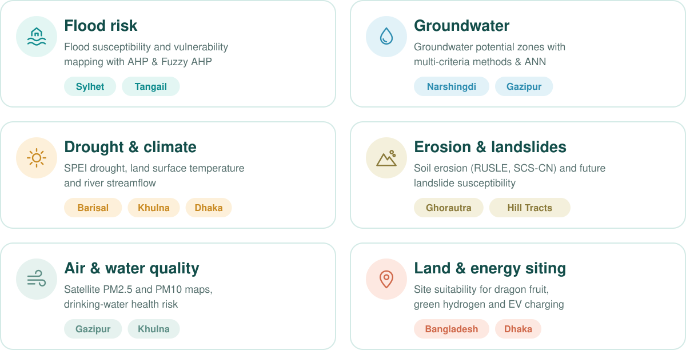
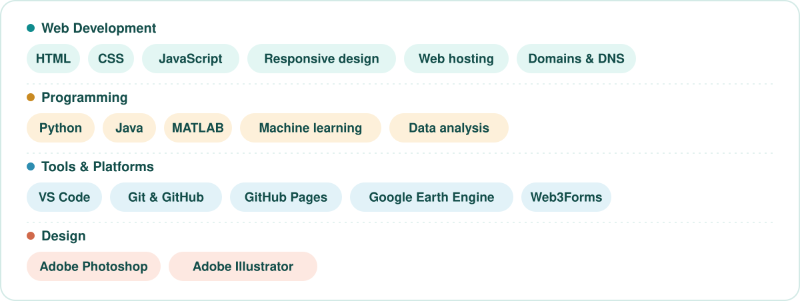

  

  
  
  
   
  
  
  

## Hello, I'm Biplob

I'm a water and environmental researcher from Bangladesh who also builds for the web. Most days I turn satellite images, climate records and field surveys into maps of flood, drought, erosion and water risk. I also design and code websites, from my own portfolio to the BlueGreen Research and Consultancy site, which I built and host myself. Away from the desk, I'm out with a camera or a drone, photographing the same rivers and fields I study.

  

### Right now

- 🔬 **Research Assistant** at the Institute of Water & Environment (IWE), DUET, since October 2026
- 🌿 **Lead Consultant, Environmental Research** at BlueGreen Research and Consultancy (BGRC), where I also design, code and host the [company website](https://www.bgrcbd.com)
- 🎓 Finishing my **MSc in Water and Environmental Management** at DUET
- 🛠️ Building a **Raster Downscaling Tool** in Python: it trains and compares machine-learning models, then downscales a coarse raster with the best one
- 📝 Under review: EV charging station siting in Dhaka, and a blue and green water security index. In progress: an environmental flow assessment of the Halda River Basin with HEC-HMS
- 🧑‍🏫 Running trainings on GIS, remote sensing, Google Earth Engine, hydrological modelling, AI and machine learning, and photography
- 🎯 Next: a **PhD in hydrology**

## Things I've built

  
  
  

## What I work on

  

## Toolbox

  

## Selected publications

1. **Hosen, M. B.**, Islam, M. R., Tahera-Tun-Humayra, U., et al. (2025). Assessing land suitability for dragon fruit cultivation in Bangladesh: A GIS-based AHP approach. *Smart Agricultural Technology*, 12, 101241. [doi:10.1016/j.atech.2025.101241](https://doi.org/10.1016/j.atech.2025.101241)
2. Aziz, M. T., Haque, A., Islam, M. R., **Hosen, M. B.**, et al. (2025). Site suitability assessment for solar-powered green hydrogen production plants: A GIS-based AHP and Fuzzy AHP approach for Bangladesh. *Renewable Energy*, 254, 123675. [doi:10.1016/j.renene.2025.123675](https://doi.org/10.1016/j.renene.2025.123675)
3. Kader, Z., Islam, M. R., Miah, M., … **Hosen, M. B.**, … & Akanda, A. S. (2026). Performance assessment of multicriteria decision making techniques and artificial neural network to predict future groundwater potential zones. *Ecological Indicators*, 183, 114619. [doi:10.1016/j.ecolind.2026.114619](https://doi.org/10.1016/j.ecolind.2026.114619)
4. Islam, M. R., **Hosen, M. B.**, Hossain, M. M., Ayejoto, D. A., & Khan, M. Y. A. (2025). Future projections of landslide susceptibility in the Hill Tracts of Bangladesh: An AHP-based approach. *Earth Systems and Environment*, 9(4), 3017–3041. [doi:10.1007/s41748-025-00776-y](https://doi.org/10.1007/s41748-025-00776-y)
5. Kundu, S., **Hosen, M. B.**, Popy, S., et al. (2026). Application of the fuzzy analytical hierarchy process for flood vulnerability assessment in Sylhet District, Bangladesh. *Discover Environment*, 4(1), 588.

<b>Show all 9 published articles</b>

 

6. Tahera-Tun-Humayra, U., Islam, M. R., **Hosen, M. B.**, et al. (2025). Groundwater potential zone mapping using analytical hierarchy process (AHP) and GIS for Narshingdi District, Bangladesh. *Environmental Challenges*, 21, 101335. [doi:10.1016/j.envc.2025.101335](https://doi.org/10.1016/j.envc.2025.101335)
7. Sharker, R., Islam, M. R., **Hosen, M. B.**, et al. (2025). GIS-based AHP approach to flood susceptibility assessment in Tangail district, Bangladesh. *Journal of Earth System Science*, 134(1), 26. [doi:10.1007/s12040-024-02480-3](https://doi.org/10.1007/s12040-024-02480-3)
8. Miah, M., Islam, M. R., Imran, H. M., … **Hosen, M. B.**, … & Hasan, M. (2025). Assessing soil erosion in the Ghorautra River Basin of Bangladesh: Using SCS-CN and RUSLE methods within the GIS-RS framework. *Journal of the Indian Society of Remote Sensing*, 53(12), 4383–4403. [doi:10.1007/s12524-025-02276-y](https://doi.org/10.1007/s12524-025-02276-y)
9. Bhowmik, D., Kader, Z., **Hosen, M. B.**, & Hossain, S. (2025). Exploring socioeconomic vulnerability and natural disasters impacts on water access in Southwestern Bangladesh. *DYSONA – Applied Science*, 6(1), 186–199. [doi:10.30493/das.2024.483646](https://doi.org/10.30493/das.2024.483646)

🎤 I have also presented 17 papers at national and international conferences in Bangladesh.

## Experience

**Research Assistant** · Institute of Water & Environment (IWE), DUET · *Oct 2026 – present*

**Lead Consultant, Environmental Research** · BlueGreen Research and Consultancy (BGRC) · *2025 – present* 
GIS and remote sensing, hydrological modelling, IEE and EIA, and flood and drought risk. Since August 2026 I have also designed, coded and hosted the [BGRC website](https://www.bgrcbd.com).

**Research Assistant** · Institute of Water & Environment (IWE), DUET · *2024 – 2026* 
Led data collection, analysis and final reporting for two UGC-funded research projects: EV charging station siting in Dhaka District with AHP, Fuzzy AHP and ANN, and water security in the Shitalakshya River Basin through blue and green water footprints.

**Research Associate** · M/S Tuhin Associates · *2024 – 2025* 
GCA-funded research on reducing erosion at Kuakata Sea Beach, carried out at IWFM, BUET, with fieldwork on the beach. In November 2025 I also made a video documentary for GCA's Coastal Towns Climate Resilience Project.

## Education & training

**MSc in Water and Environmental Management** · Dhaka University of Engineering & Technology (DUET), Gazipur 
CGPA 3.92 / 4.00 · thesis in progress

**BSc (Hons) in Environmental Science and Disaster Management** · Gopalganj Science and Technology University 
Thesis: effects of saline water intrusion on agriculture in Gobra Union, Gopalganj (with field survey)

**Training:** Basic Python, 60 hours, IICT, DUET (2026) · Numerical Modelling, AI and GIS Technology (2023) · Application of GIS and Remote Sensing in Research (2022)

**Languages:** Bangla, English, Hindi and Urdu, all fluent

## Behind the camera

I founded **DUET_ps**, the DUET Photographic Society, and served as its Chief Instructor (2024–25). I'm now its Advisor (2025–present). Before that I was a member of the GSTU Photographic Society (2018–2023). I shoot landscapes, birds, flowers and foggy mornings on a **Canon EOS 77D**, and fly a **DJI Air 2S** for aerial photography and drone surveys.

  
  
  

## Leadership & volunteering

- Environmental Secretary and Photography Secretary, Rangpur Divisional Student Association (RDSA), GSTU
- Environment Related Secretary, Green Voice, GSTU branch (2020–2023) · Convener, Green Voice, Ranisankail Upazila branch
- Disaster and Relief Affairs Editor, Khola Kagoj Pathok Forum "Egarojon", BSMRSTU (2019–2023)
- Environmental Compliance Inspector, Keya Students Forum Bangladesh (2020–2023)
- Campus Journalist, Bishal Bangla Online (2020–2023)
- Member, Thakurgaon Students Association, GSTU

 

  

