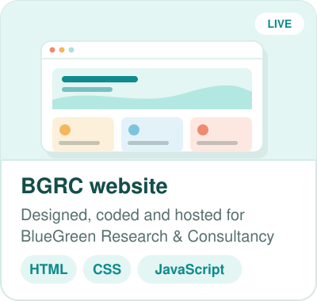

  

  
  
  
  

## Hi, I'm Biplob 👋

I build clean, fast websites and small Python tools that make data easier to work with. I designed, coded and host the website of BlueGreen Research and Consultancy, built my own portfolio from scratch, and I'm now writing a Python desktop tool that uses machine learning to sharpen coarse raster data. I like code that is simple enough for anyone to update.

  

### Right now

- 🌐 Maintaining and hosting the [BGRC website](https://www.bgrcbd.com), which I have built and run since August 2026
- 🎨 Improving my portfolio at [biplobhosen.com](https://biplobhosen.com)
- 🛠️ Building a **Raster Downscaling Tool** in Python: a desktop app that trains and compares machine-learning models, then downscales a coarse raster with the best one
- 🌱 Learning more Python, JavaScript, and AI and machine learning
- 💬 Ask me about HTML, CSS, JavaScript, Python, GitHub Pages, and setting up domains

## Things I've built

  
  
  

| Project | What I did | Built with |
|---|---|---|
| [BGRC website](https://www.bgrcbd.com) | Designed, coded and hosted a company website | HTML, CSS, JavaScript |
| [biplobhosen.com](https://biplobhosen.com) | Personal site with popups, a photo gallery, a travel blog, a contact form and a custom domain | HTML, CSS, JavaScript, GitHub Pages, Web3Forms |
| Raster Downscaling Tool *(in progress)* | Desktop app that trains, compares and applies machine-learning models to raster data | Python, machine learning |

## Tech stack

  

## Learning

**Basic Python**, 60-hour professional course · IICT, DUET (2026)

I also run hands-on workshops on Google Earth Engine, and on AI and machine learning.

---

  Looking for my research work? It lives on my other profile:  
  

 

  

